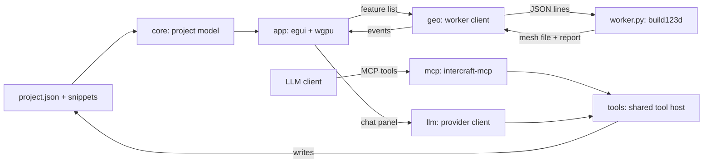

# InterCraft

A desktop tool for watching an LLM build a parametric CAD model, one feature at a time. It is not a CAD package. The model is a list of small build123d snippets, and the app rebuilds and redraws the part every time one of them changes.

> [!note]
> Status: milestone 3. An LLM can edit the model from the built-in chat panel (API key or your own Claude Code) or from any MCP client. Projects can be created, opened and exported from the menus. The sketch panel is not built yet.

## Requirements

| Tool | Version used |
|---|---|
| Rust | 1.99 (stable, MSVC) |
| eframe / egui | 0.36.2 (wgpu 30) |
| egui_dock | 0.21.1 |
| ureq | 3.5 (HTTP client for the chat) |
| keyring | 4.2 (stores the API key) |
| Python | 3.11 |
| build123d | 0.13.0 |
| numpy | 2.4.6 |

## Setup

Create the Python environment once. It lives outside OneDrive so it does not sync.

```powershell
py -3.11 -m venv "$env:LOCALAPPDATA\InterCraft\venv"
& "$env:LOCALAPPDATA\InterCraft\venv\Scripts\python.exe" -m pip install -r worker\requirements.txt
```

Set `INTERCRAFT_PYTHON` if you want to use a different interpreter.

If the repo sits in a synced folder (OneDrive, Dropbox), keep Cargo's build output outside it with a local `.cargo/config.toml` (not tracked by Git):

```toml
[build]
target-dir = "C:/Users/<you>/AppData/Local/InterCraft/target"
```

## Run

```powershell
cargo run                      # opens your last project (the example the first time)
cargo run -- path\to\project   # opens a specific project folder
```

The geometry worker takes about ten seconds to start the first time, because it has to load OpenCascade.

To see the live update, leave the app open and change a value in `examples/bracket/project.json` (for example `bore_d`) or edit one of the snippets. The part rebuilds when you save.

### Panels

| Panel | What it shows |
|---|---|
| Parts | Every part in the project, with its viewport colour, build status and volume. Click one to select it. |
| Timeline | The steps of the selected part, oldest first, with the prompt that made each one. Click a step to see the part as it was then, or Latest to go back. |
| Inspector | The selected step's prompt, parameters and numbers (volume, change, size, faces, build time). |

### Menus

| Menu | What it does |
|---|---|
| File | New project (Ctrl+N), Open project (Ctrl+O), Open recent, Show project folder, Quit |
| Export | The selected part or all parts as STEP (exact, editable) or STL (for printing), into the project's `exports` folder |
| View | Fit to view, show or hide panels, Reset layout, theme (System, Dark, Light) |
| Settings | Chat provider, model, effort, API key and theme (Ctrl+,) |

New projects go in `Documents\InterCraft Projects` unless you pick another folder.

### Viewport controls

| Action | Input |
|---|---|
| Orbit | Left drag |
| Pan | Right or middle drag |
| Zoom | Scroll |
| Fit to view | Double click |

## Driving it from an LLM

There are three ways in. All use the same tools, so the model behaves the same either way.

| Route | Who it suits | Billing |
|---|---|---|
| Chat panel with an API key | Anyone with an Anthropic API key | Your API account |
| Chat panel through Claude Code | Claude Pro or Max subscribers with Claude Code installed | Your subscription |
| MCP server from an agent app | People who work in Claude Code, Codex CLI, Gemini CLI or Cursor | Whatever that app uses |

### Built-in chat

1. Open Settings (the Settings menu, or the button at the top of the chat).
2. Choose what to use:
   - **Anthropic API key.** Paste a key and press Save. It is stored in the system credential store (Windows Credential Manager, macOS Keychain or Secret Service on Linux), never in a file. If `ANTHROPIC_API_KEY` is set, that is used instead. Pick a model and effort (Claude Opus 5.5 at high effort is the default).
   - **Claude Code (your subscription).** Needs Claude Code installed and signed in (run `claude` once in a terminal). InterCraft starts your own Claude Code in the background and shows its replies here. Pick a model or keep your Claude Code default.
3. Describe the part. Enter sends, Shift+Enter starts a new line, Stop ends the reply.

While it works you see its short notes between steps, each tool call with its result (green for built, red for failed), and the viewer follows the part being edited. Replies are formatted (headings, lists, tables, code). When a choice is genuinely yours, the model can ask with clickable options, and your pick goes back as your next message. The size of the last request and how much came from the prompt cache show under the buttons.

The Claude Code session is locked down: no built-in tools (no shell or file editing), no other MCP servers, and only the InterCraft tools allowed. It runs in the project folder with your personal hooks and settings left out. InterCraft never reads your Claude login; the unmodified `claude` program signs in by itself. The conversation is a normal Claude Code session, so `claude --resume` can pick it up in a terminal.

> [!note]
> Anthropic does not allow third-party apps to offer claude.ai login or to route requests through someone else's subscription. Here each person runs their own Claude Code with their own sign-in, which the docs allow, but check Anthropic's current terms before publishing InterCraft.

Each message also tells the model which part you have selected, so "make the bore bigger" refers to the part you are looking at.

To test the chat without an API key or any cost, run the mock server in `dev/mock_anthropic.py` and point the app at it with `INTERCRAFT_ANTHROPIC_URL`. The script's header explains how.

### MCP server (Claude Code and other agent apps)

This is the route for a Claude Pro or Max subscription, since subscriptions work in Claude Code but not as API keys. `intercraft-mcp` edits whichever project the viewer has open, so there is nothing to configure per project.

1. Start the viewer on a project: `cargo run -- projects\demo` (a new folder is fine, the first edit creates it).
2. Connect Claude Code:
   - Inside this repo, `.mcp.json` already lists the `intercraft` server. Run `claude` here and approve it.
   - To use it from any folder, register it once: `claude mcp add --scope user intercraft -- python "<repo>/dev/mcp_launcher.py"`. The chat panel has a button that copies this command with the right path.
3. Check `/mcp` shows `intercraft` as connected, then ask for a part, for example "make a 60 x 40 x 5 plate with four M4 holes".

`dev/mcp_launcher.py` builds the server and runs a copy of it, so a running server never blocks the next build. Pass a folder to pin the server to one project instead of following the viewer.

| Tool | What it does |
|---|---|
| `get_project` | Returns every part, feature, snippet and the current build numbers |
| `add_part` | Creates an empty design part |
| `add_feature` | Adds one modelling step and builds it |
| `edit_feature` | Changes a feature's code, label or parameters |
| `set_param` | Changes one dimension |
| `delete_feature` | Removes a feature |
| `export_part` | Writes STEP and STL to the project's `exports` folder |

Every edit returns a build report (volume, volume change, size, errors), so the LLM can check its own work with numbers. A feature that fails to build stays saved and shows red in the app until it is fixed.

Other MCP clients (Codex CLI, Gemini CLI, Cursor) use the same command: `python <repo>/dev/mcp_launcher.py` as a stdio server.

## How a project is stored

A project is a folder with a `project.json` and one Python snippet per feature.

```
examples/bracket/
  project.json            parts, feature order, labels, prompts, parameters
  RodBracket/
    010_base.py
    020_bore.py
    ...
```

Each snippet is build123d code that reads and reassigns `part`. Its parameters arrive in `p`. All lengths are in mm.

```python
bore = Rot(90, 0, 0) * Cylinder(p["bore_d"] / 2, 100)
part = part - bore
```

## How it fits together

<div style="width:70%">



</div>

| Folder | Purpose |
|---|---|
| `crates/core` | Project model and loading |
| `crates/geo` | `GeometryBackend` trait and the Python worker client |
| `crates/app` | Window, docked panels and the 3D viewport |
| `crates/tools` | The editing tools and model guide, shared by the chat panel and the MCP server |
| `crates/llm` | Provider-neutral chat interface and the Anthropic client |
| `crates/mcp` | MCP server that exposes the tools |
| `worker` | Runs the snippets, caches each step, writes meshes and reports |

The worker caches the shape after every feature. Changing one feature only rebuilds from that feature onwards.

> [!warning]
> Snippets are Python written by a model or by whoever made the project. They run in a sandbox (no imports, file access or Python internals), with a 4 GB memory cap and a 60 second limit per step, but it is not full OS isolation. Only open projects you trust. See [docs/security-review.md](docs/security-review.md) for the full review.

## Tests

```powershell
cargo test --workspace
& "$env:LOCALAPPDATA\InterCraft\venv\Scripts\python.exe" -m unittest worker/test_sandbox.py
```

The suites include stress tests for both chat routes (a fake Messages API and a fake `claude`), sandbox escape attempts, and tool tests that use the real geometry worker. Those skip themselves when the Python environment isn't set up.

## Roadmap

1. Viewer with live rebuild from files (done)
2. Tool API and MCP server so an LLM can drive it (done)
3. Built-in chat panel with the Anthropic API or your own Claude Code (done)
4. Menus, project navigation, rich text and choice questions (done)
5. OS-level isolation for the geometry worker
6. OpenAI-compatible client (OpenAI, OpenRouter, local models through Ollama or LM Studio)
7. Editing steps from the timeline and Inspector, with undo
8. Sketch panel
9. Fit checks, section view, before and after overlay
