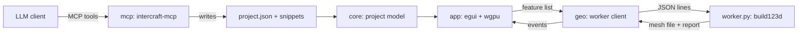

# InterCraft

A desktop tool for watching an LLM build a parametric CAD model, one feature at a time. It is not a CAD package. The model is a list of small build123d snippets, and the app rebuilds and redraws the part every time one of them changes.

> [!note]
> Status: milestone 2. The viewer works from files on disk, and an LLM can edit the model through the MCP server. The built-in chat and sketch panels are not built yet.

## Requirements

| Tool | Version used |
|---|---|
| Rust | 1.99 (stable, MSVC) |
| eframe / egui | 0.36.2 (wgpu 30) |
| egui_dock | 0.21.1 |
| Python | 3.11 |
| build123d | 0.13.0 |
| numpy | 2.4.6 |

## Setup

Create the Python environment once. It lives outside OneDrive so it does not sync.

```powershell
py -3.11 -m venv "$env:LOCALAPPDATA\InterCraft\venv"
& "$env:LOCALAPPDATA\InterCraft\venv\Scripts\python.exe" -m pip install -r worker\requirements.txt
```

Set `INTERCRAFT_PYTHON` if you want to use a different interpreter.

## Run

```powershell
cargo run                      # opens examples/bracket
cargo run -- path\to\project   # opens another project folder
```

The geometry worker takes about ten seconds to start the first time, because it has to load OpenCascade.

To see the live update, leave the app open and change a value in `examples/bracket/project.json` (for example `bore_d`) or edit one of the snippets. The part rebuilds when you save.

### Viewport controls

| Action | Input |
|---|---|
| Orbit | Left drag |
| Pan | Right or middle drag |
| Zoom | Scroll |
| Fit to view | Double click |

## Driving it from an LLM

`intercraft-mcp` is an MCP server (stdio) that edits a project folder. The app watches the same folder, so each tool call shows up in the viewport as it happens.

1. Open the viewer on the working project: `cargo run -- projects\demo`
2. Start Claude Code in this repo. It reads `.mcp.json` and offers the `intercraft` server, which uses the same `projects/demo` folder.
3. Ask for a part, for example "make a 60 x 40 x 5 plate with four M4 holes".

| Tool | What it does |
|---|---|
| `get_project` | Returns every part, feature, snippet and the current build numbers |
| `add_part` | Creates an empty design part |
| `add_feature` | Adds one modelling step and builds it |
| `edit_feature` | Changes a feature's code, label or parameters |
| `set_param` | Changes one dimension |
| `delete_feature` | Removes a feature |
| `export_part` | Writes STEP and STL to the project's `exports` folder |

Every edit returns a build report (volume, volume change, size, errors), so the LLM can check its own work with numbers. A feature that fails to build stays saved and shows red in the app until it is fixed.

For any other MCP client, run `intercraft-mcp <project folder>` as a stdio server.

## How a project is stored

A project is a folder with a `project.json` and one Python snippet per feature.

```
examples/bracket/
  project.json            parts, feature order, labels, prompts, parameters
  RodBracket/
    010_base.py
    020_bore.py
    ...
```

Each snippet is build123d code that reads and reassigns `part`. Its parameters arrive in `p`. All lengths are in mm.

```python
bore = Rot(90, 0, 0) * Cylinder(p["bore_d"] / 2, 100)
part = part - bore
```

## How it fits together

<div style="width:70%">



</div>

| Folder | Purpose |
|---|---|
| `crates/core` | Project model and loading |
| `crates/geo` | `GeometryBackend` trait and the Python worker client |
| `crates/app` | Window, docked panels and the 3D viewport |
| `crates/mcp` | MCP server with the editing tools |
| `worker` | Runs the snippets, caches each step, writes meshes and reports |

The worker caches the shape after every feature. Changing one feature only rebuilds from that feature onwards.

> [!warning]
> The worker runs the snippets as normal Python on your machine. Only open projects you trust.

## Roadmap

1. Viewer with live rebuild from files (done)
2. Tool API and MCP server so an LLM can drive it (done)
3. Chat panel and prompt-linked timeline editing
4. Sketch panel
5. Fit checks, section view, before and after overlay
