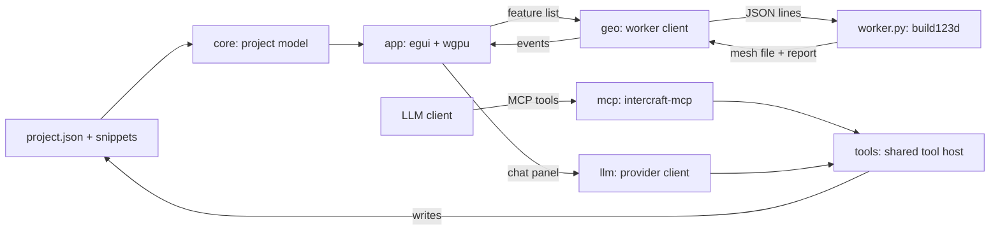

# InterCraft

A desktop tool for watching an LLM build a parametric CAD model, one feature at a time. It is not a CAD package. The model is a list of small build123d snippets, and the app rebuilds and redraws the part every time one of them changes.

> [!note]
> Status: milestone 3. An LLM can edit the model from the built-in chat panel (API key or your own Claude Code) or from any MCP client. Projects can be created, opened and exported from the menus. The sketch panel is not built yet.

## Requirements

| Tool | Version used |
|---|---|
| Rust | 1.99 (stable, MSVC) |
| eframe / egui | 0.36.2 (wgpu 30) |
| egui_dock | 0.21.1 |
| ureq | 3.5 (HTTP client for the chat) |
| keyring | 4.2 (stores the API key) |
| Python | 3.11 |
| build123d | 0.13.0 |
| numpy | 2.4.6 |

## Setup

Create the Python environment once. It lives outside OneDrive so it does not sync.

```powershell
py -3.11 -m venv "$env:LOCALAPPDATA\InterCraft\venv"
& "$env:LOCALAPPDATA\InterCraft\venv\Scripts\python.exe" -m pip install -r worker\requirements.txt
```

Set `INTERCRAFT_PYTHON` if you want to use a different interpreter.

`worker
equirements.lock` lists the exact version of every package in that environment. Install from it instead when you want the same versions CI tests and audits.

If the repo sits in a synced folder (OneDrive, Dropbox), keep Cargo's build output outside it with a local `.cargo/config.toml` (not tracked by Git):

```toml
[build]
target-dir = "C:/Users/<you>/AppData/Local/InterCraft/target"
```

## Run

```powershell
cargo run                      # opens your last project (the example the first time)
cargo run -- path\to\project   # opens a specific project folder
```

The geometry worker takes about ten seconds to start the first time, because it has to load OpenCascade.

To see the live update, leave the app open and change a value in `examples/bracket/project.json` (for example `bore_d`) or edit one of the snippets. The part rebuilds when you save.

### Panels

| Panel | What it shows |
|---|---|
| Parts | Every part in the project, with its viewport colour, build status and volume. Click one to select it, click the eye to hide or show it, and right-click for Show only this, Show all, Rename, Duplicate, Lock, Unlock and Delete. Delete removes the selected part while the pointer is over the list. |
| Timeline | The steps of the selected part, oldest first. Each card shows why the step is there (the design reason the model gave), or the prompt that made it. Click a step to see the part as it was then, or Latest to go back. Right-click a step to move it earlier or later, rename it or delete it. |
| Brief | The project's design brief: what it is, how it will be made, key dimensions, decisions and open items. The model asks you about it for a new project and keeps it up to date. Edit brief changes it yourself. |
| Sketch | A drawing pad for rough, annotated sketches that go to the model with a chat message, in a tab beside the 3D view. See Sketching below. |
| Inspector | The selected step's design reason ("Why"), prompt, parameters and numbers (volume, change, size, faces, build time). Drag a number to change it and watch the part rebuild as you drag. It is saved when you let go, as one undo step. Click a number to type an exact value. "Why is it like this?" asks the model to explain the step in plain words, and right-clicking a part offers "Explain this part". Placement, at the top, moves and turns the selected part in the assembly the same way. Code shows the step's snippet. Edit it and press Apply (Ctrl+Enter) to save and rebuild, or Revert to drop the edit. |

### Menus

| Menu | What it does |
|---|---|
| File | New project (Ctrl+N), Open project (Ctrl+O), Import STEP, Open recent, Show project folder, Quit |
| Edit | Undo (Ctrl+Z), Redo (Ctrl+Y or Ctrl+Shift+Z), and History, which lists every change and jumps to any of them |
| Export | The selected part or all parts as STEP (exact, editable) or STL (for printing), into the project's `exports` folder |
| View | Fit to view, show or hide panels, Reset layout, theme (System, Dark, Light) |
| Settings | Chat provider, model, effort, API key and theme (Ctrl+,) |

New projects go in `Documents\InterCraft Projects` unless you pick another folder.

### Viewport controls

| Action | Input |
|---|---|
| Orbit | Left drag |
| Pan | Right or middle drag |
| Zoom | Scroll |
| Fit to view | Double click, or F |
| Measure | M, or the Measure button (Esc clears) |
| Show or hide edges | E |
| Hide or show the selected part | H |
| Section view | S, or the Section button |
| Fit check | The Fit check button |

### Measuring

Turn on Measure and click a corner, edge or face. Corners and edges snap when the cursor is close. One click describes what you picked (an edge's length, a circle's diameter and centre, a corner's position). A second click gives the distance between the two, the X, Y and Z offsets, and the angle when both are straight edges or flat faces. The numbers come from the CAD kernel, so they are exact for corners and edges. A point on a curved face comes from the mesh, which is within 0.05 mm.

### Sketching

The Sketch tab is a rough drawing pad for showing the model what you mean. It is not a CAD sketcher and nothing drawn on it becomes geometry. The model reads it and builds the part itself.

| Tool | How |
|---|---|
| Pen | Drag to draw freehand. |
| Line, Arrow, Rectangle, Circle | Drag from one point to the other. |
| Label | Click where the text should go, then type. |
| Dimension | Drag between two points, then type the size you want. Leave it empty to show the length as drawn. |
| Erase | Click something to remove it. |

There are six pen colours. Give a colour a meaning in the Colour key row (for example red for "cut away" and blue for "keep clear") and the key appears on the sketch as a legend. Right drag pans, scroll zooms and Backspace removes the last thing drawn.

**Draw over** puts a flat view of the model (top, front, right, back, left or bottom) behind the sketch at true scale, so you can mark up one of its faces. Sketch positions then match the model's own coordinates on that view.

**Attach to chat** adds the sketch to your next message. The model receives a picture of it and a written summary: which view it was drawn over, the colour key, every label and dimension, and the rough position of each shape. The summary means the labels and numbers still get through to a model that can't read images.

### Section view

Section cuts the model open with a plane across X, Y or Z. Drag the slider to move the plane and use Flip to cut away the other side. The cut face is filled and hatched in each part's colour, so walls, pockets and bores are easy to judge. Measuring ignores whatever has been cut away.

### Assemblies and the fit check

Each part has a placement: a position in mm and a rotation in degrees about X, Y and Z. Set it under Placement in the Inspector. Features never see the placement. A snippet always works in the part's own frame, so moving a part can't break it. Right-click a part to duplicate or rename it.

Fit check compares every pair of visible parts on the real CAD shapes. A pair either clashes, with the overlapping volume listed and drawn in red through the parts, or is clear, with the smallest gap listed. Hover a row to see where the gap is. The check runs again by itself after each change while its panel is open.

### Importing STEP files

File > Import STEP (or the button under the parts list) copies the file into the project's `imports` folder and adds a part that starts from it. The import is step 1 on the timeline, and the model can add features on top of it: holes, pockets, fillets. Right-click a part to lock it as a reference (so the model designs around it but can't change it) or unlock it for editing.

### Undo and history

Every change is recorded, whoever made it: you in the app, the chat panel, or an agent through MCP. Edit > Undo steps back one change and Edit > History jumps to any point, so a bad edit from the model costs nothing. Edits made in a text editor are kept too. Undo reverts them as one step instead of losing them.

The history lives in the project's `.intercraft/history` folder, one snapshot per change, up to the last 200. A deleted part's imported STEP file stays in `imports`, so undo can bring the part back.

## Driving it from an LLM

There are four ways in. All use the same tools, so the model behaves the same either way.

| Route | Who it suits | Billing |
|---|---|---|
| Chat panel with an API key | Anyone with an Anthropic API key | Your API account |
| Chat panel through Claude Code | Claude Pro or Max subscribers with Claude Code installed | Your subscription |
| Chat panel with an OpenAI-compatible server | OpenAI or OpenRouter accounts, or a local model in Ollama or LM Studio | That service, or nothing for a local model |
| MCP server from an agent app | People who work in Claude Code, Codex CLI, Gemini CLI or Cursor | Whatever that app uses |

### Built-in chat

1. Open Settings (the Settings menu, or the button at the top of the chat).
2. Choose what to use:
   - **Anthropic API key.** Paste a key and press Save. It is stored in the system credential store (Windows Credential Manager, macOS Keychain or Secret Service on Linux), never in a file. If `ANTHROPIC_API_KEY` is set, that is used instead. Pick a model and effort (Claude Opus 5.5 at high effort is the default).
   - **Claude Code (your subscription).** Needs Claude Code installed and signed in (run `claude` once in a terminal). InterCraft starts your own Claude Code in the background and shows its replies here. Pick a model or keep your Claude Code default.
   - **OpenAI-compatible server.** Set the server address (Pick lists OpenAI, OpenRouter, Ollama and LM Studio), type the model's id on that server, and save a key if the server needs one. Each server has its own saved key, so a key is never sent to a server it wasn't saved for. The address must be HTTPS unless the server runs on this computer. Tick "This model can read images" only for models that can, since that is what lets them use `view_model`. Small local models often struggle with tool calls, so expect better results from larger ones.
3. Describe the part. Enter sends, Shift+Enter starts a new line, Stop ends the reply.

While it works you see its short notes between steps, each tool call with its result (green for built, red for failed), and the viewer follows the part being edited. Replies are formatted (headings, lists, tables, code). When a choice is genuinely yours, the model can ask with clickable options, and your pick goes back as your next message. The size of the last request and how much came from the prompt cache show under the buttons.

The Claude Code session is locked down: no built-in tools (no shell or file editing), no other MCP servers, and only the InterCraft tools allowed. It runs in the project folder with your personal hooks and settings left out. InterCraft never reads your Claude login; the unmodified `claude` program signs in by itself. The conversation is a normal Claude Code session, so `claude --resume` can pick it up in a terminal.

> [!note]
> Anthropic does not allow third-party apps to offer claude.ai login or to route requests through someone else's subscription. Here each person runs their own Claude Code with their own sign-in, which the docs allow, but check Anthropic's current terms before publishing InterCraft.

Each message also tells the model which part you have selected, so "make the bore bigger" refers to the part you are looking at.

To test the chat without an API key or any cost, run the mock server in `dev/mock_anthropic.py` and point the app at it with `INTERCRAFT_ANTHROPIC_URL`. The script's header explains how.

### MCP server (Claude Code and other agent apps)

This is the route for a Claude Pro or Max subscription, since subscriptions work in Claude Code but not as API keys. `intercraft-mcp` edits whichever project the viewer has open, so there is nothing to configure per project.

1. Start the viewer on a project: `cargo run -- projects\demo` (a new folder is fine, the first edit creates it).
2. Connect Claude Code:
   - Inside this repo, `.mcp.json` already lists the `intercraft` server. Run `claude` here and approve it.
   - To use it from any folder, register it once: `claude mcp add --scope user intercraft -- python "<repo>/dev/mcp_launcher.py"`. The chat panel has a button that copies this command with the right path.
3. Check `/mcp` shows `intercraft` as connected, then ask for a part, for example "make a 60 x 40 x 5 plate with four M4 holes".

`dev/mcp_launcher.py` builds the server and runs a copy of it, so a running server never blocks the next build. Pass a folder to pin the server to one project instead of following the viewer.

| Tool | What it does |
|---|---|
| `get_project` | Returns every part, feature, snippet and the current build numbers |
| `add_part` | Creates an empty design part |
| `add_feature` | Adds one modelling step and builds it |
| `edit_feature` | Changes a feature's code, label or parameters |
| `set_param` | Changes one dimension |
| `move_feature` | Changes the order of a part's features |
| `delete_feature` | Removes a feature |
| `update_brief` | Replaces one section of the design brief |
| `delete_part` | Removes a design part (reference parts can only be removed by you) |
| `place_part` | Moves or turns a design part in the assembly |
| `duplicate_part`, `rename_part` | Copies or renames a part |
| `check_fit` | Clashes (with volume) and clearances between parts |
| `view_model` | A picture of the model from the viewer: iso, front, back, left, right, top, bottom or your current view, optionally cut open or showing one part. The six side views are drawn flat, like a drawing |
| `undo`, `redo` | Step back or forward through the project history |
| `inspect_part` | Faces, holes and circular edges of a part with exact sizes and positions |
| `measure` | Exact distance, angle, length or diameter between faces, edges, corners and points |
| `export_part` | Writes STEP and STL to the project's `exports` folder |

Every edit returns a build report (volume, volume change, size, errors), so the LLM can check its own work with numbers. With `view_model` it can also look at the result, which catches mistakes numbers miss, such as a hole on the wrong face. The picture is drawn by the open viewer without changing your own view, so that tool needs the viewer running. A feature that fails to build stays saved and shows red in the app until it is fixed.

Other MCP clients (Codex CLI, Gemini CLI, Cursor) use the same command: `python <repo>/dev/mcp_launcher.py` as a stdio server.

## How a project is stored

A project is a folder with a `project.json` and one Python snippet per feature.

```
examples/bracket/
  project.json            parts, feature order, labels, prompts, parameters
  brief.md                the design brief, in Markdown
  .intercraft/history/    undo snapshots (not needed to share the project)
  .intercraft/view/       picture requests from the model, removed once answered
  RodBracket/
    010_base.py
    020_bore.py
    ...
```

Each snippet is build123d code that reads and reassigns `part`. Its parameters arrive in `p`. All lengths are in mm.

```python
bore = Rot(90, 0, 0) * Cylinder(p["bore_d"] / 2, 100)
part = part - bore
```

## How it fits together

<div style="width:70%">



</div>

| Folder | Purpose |
|---|---|
| `crates/core` | Project model and loading |
| `crates/geo` | `GeometryBackend` trait and the Python worker client |
| `crates/app` | Window, docked panels and the 3D viewport |
| `crates/tools` | The editing tools and model guide, shared by the chat panel and the MCP server |
| `crates/llm` | Provider-neutral chat interface, with clients for the Anthropic API, Claude Code and OpenAI-compatible servers |
| `crates/mcp` | MCP server that exposes the tools |
| `worker` | Runs the snippets, caches each step, writes meshes and reports |

The worker caches the shape after every feature. Changing one feature only rebuilds from that feature onwards.

> [!warning]
> Snippets are Python written by a model or by whoever made the project. They run in a sandbox (no imports, file access or Python internals), with a 4 GB memory cap and a 60 second limit per step, but it is not full OS isolation. Only open projects you trust. See [docs/security-review.md](docs/security-review.md) for the full review.

## Tests

```powershell
cargo test --workspace
& "$env:LOCALAPPDATA\InterCraft\venv\Scripts\python.exe" -m unittest worker/test_sandbox.py
```

The suites include stress tests for both chat routes (a fake Messages API and a fake `claude`), sandbox escape attempts, and tool tests that use the real geometry worker. Those skip themselves when the Python environment isn't set up.

Every push and pull request runs both suites on Windows in GitHub Actions, together with `cargo audit` and `pip-audit` on the dependencies. The audits also run every Monday.

## Roadmap

Done:

1. Viewer with live rebuild from files
2. Tool API and MCP server so an LLM can drive it
3. Built-in chat panel with the Anthropic API or your own Claude Code
4. Menus, project navigation, rich text and choice questions
5. STEP import, edge display, measuring tool, and inspect and measure tools for the model
6. Undo and history, hiding and deleting parts and steps
7. Editing parameters in the Inspector with a live preview
8. Section view, part placement, rename and duplicate, fit check, and pictures for the model
9. Reordering, renaming and editing the code of steps, and CI
10. OpenAI-compatible chat (OpenAI, OpenRouter, Ollama, LM Studio)
11. Sketch panel: rough annotated sketches, drawn on a blank grid or over a view of the model, sent to the model with a message

Next:

- Sketching over any face picked in the 3D view, not only the six standard views
- OS-level isolation for the geometry worker
- Memory cap and stuck-build watchdog on macOS and Linux
- Before and after overlay
